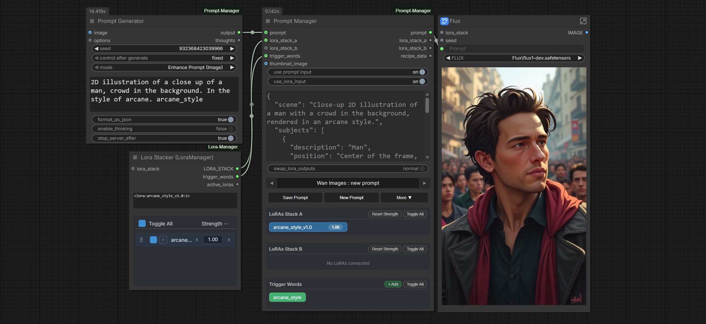
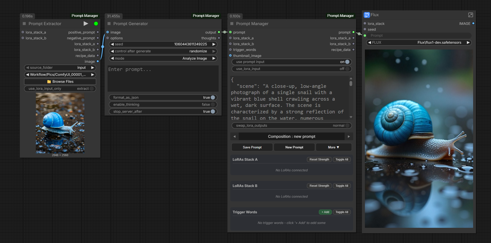
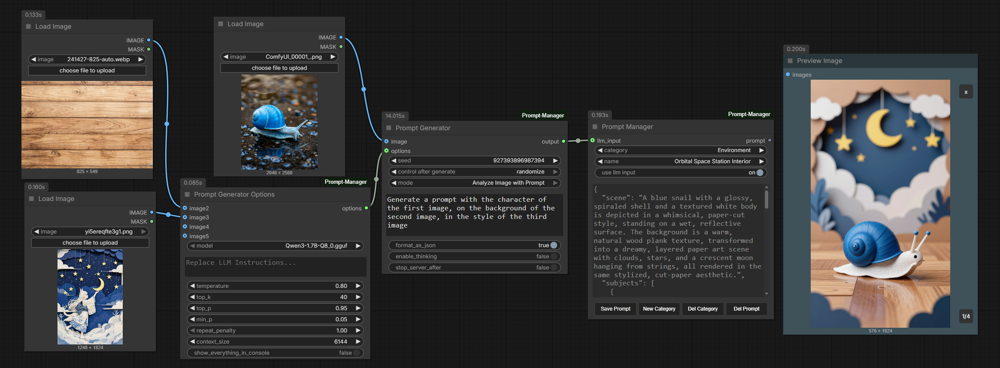
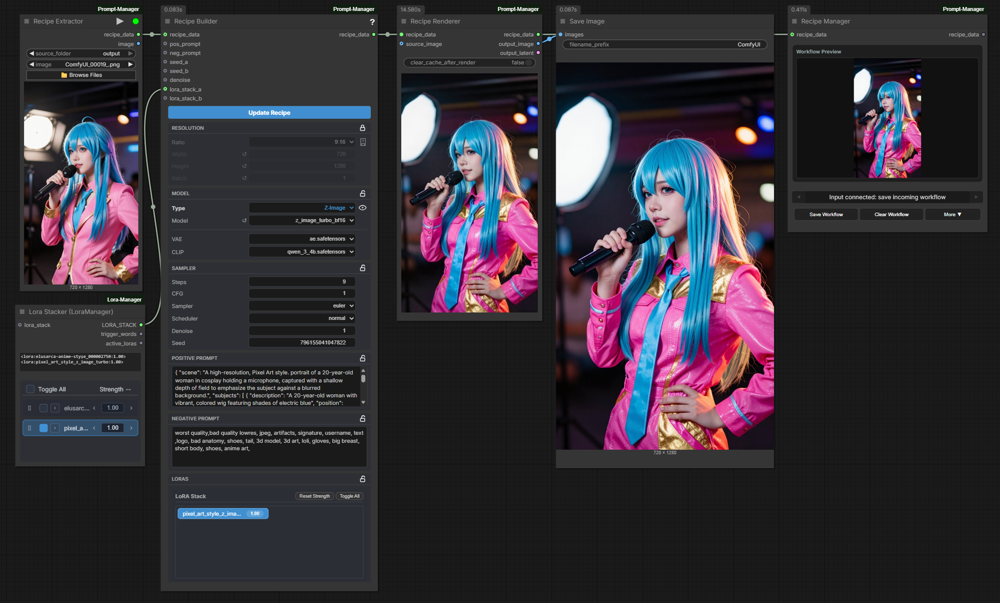
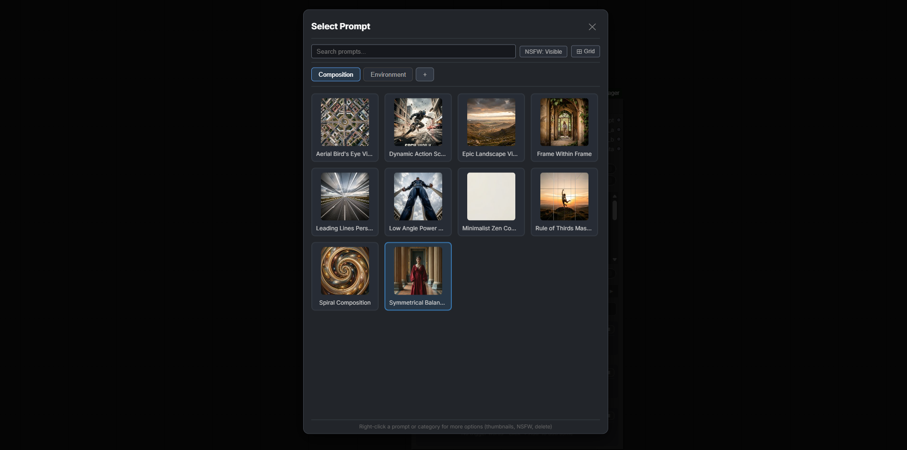
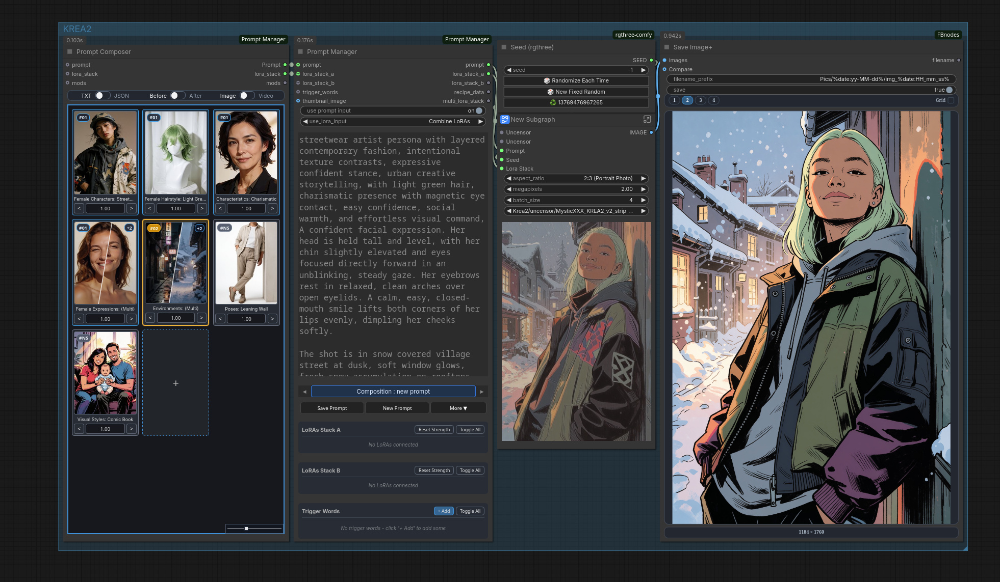
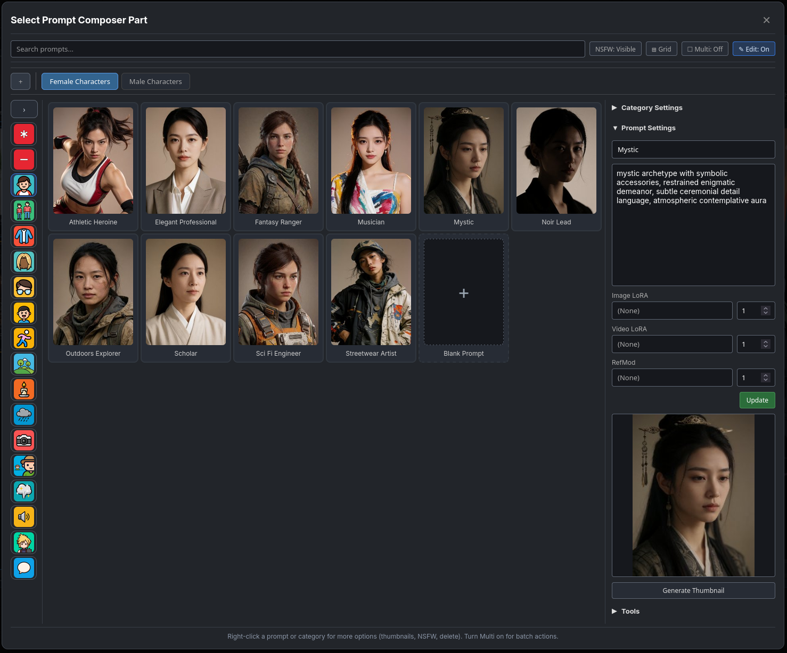

# ComfyUI Prompt Manager
## A comprehensive prompt and recipe toolkit for [ComfyUI](https://github.com/comfyanonymous/ComfyUI)

ComfyUI Prompt Manager is a prompt toolkit for ComfyUI. It helps you manage, save, and reuse prompts along with their LoRAs and trigger words. It can generate prompts using a local LLM through llama.cpp or Ollama, or generate them directly with ComfyUI’s own CLIP/text encoders. It also extracts metadata from images, videos, and JSON files, so you can turn them into reusable prompts — and the **Prompts** sidebar and save/load tools keep everything organized.

[See Installation Guide](#installation)

[See Node Reference](docs/feature-reference.md)

[See Prompt Composer](#prompt-composer)

## What This Provides

- **Prompt Manager**:
  - For saving and loading Prompts.
  - These saved prompts can include LoRA stacks, trigger words, as well as thumbnails.
- **Prompt Generator**:
  - To run a local LLM (llama.cpp or Ollama), or directly use ComfyUI's CLIP/text encoders.
  - Also supports image analysis when using Vision Capable models.
- **Prompt Composer**:
  - For building prompts from reusable prompt fragments such as attire, expression, action, style, ambience, and more.
  - Supports the v2 Prompt Composer library format with thumbnails, prompt groups, subject-aware group behavior, LoRAs, RefMods, random multi-prompt selection, and video/image composition modes.
- **Prompt Extractor**:
  - Read metadata from images/videos/JSON and output the prompt and LoRAs they use.
- **Lora Preview integration**:
  - When [Lora-Manager](https://github.com/willmiao/ComfyUI-Lora-Manager) is installed, LoRAs can be previewed on hover.
- **Advanced media loading**:
  - Extractor nodes can also act as advanced image loaders, but I'd recommend [FBNodes](https://github.com/FranckyB/ComfyUI-FBnodes) for better solutions.
- **And more**:
  - See the [Reference guide](docs/feature-reference.md) for a complete list.
---

<div align="center">
  <figcaption>Prompt Creation With Lora and Trigger Words</figcaption>
  
</div>

<div align="center">
  <figcaption>Generating Prompts based on Images</figcaption>
  
</div>

<div align="center">
  <figcaption>Advanced Prompt Generation using Multiple Images</figcaption>
  
</div>

<div align="center">
  <figcaption>Recipe extraction and modification (Adding a Style LoRA)</figcaption>
  
</div>

<div align="center">
  <figcaption>Easily find saved Prompts & Recipes using the Built-in File Browser</figcaption>
  
</div>


## Toolset Overview

### Prompt Toolset

- Prompt Manager: Supports Prompts, LoRA stacks, trigger words and thumbnail for workflows.
- Prompt Manager (Basic): Simple no-frills basic version (The OG).
- Prompt Generator: prompt creation and enhancement using llama.cpp, Ollama, or a connected ComfyUI CLIP/text encoder.
- Prompt Extractor: Reads metadata from images/videos/JSON and outputs prompt + LoRA + recipe context.
- Prompt Composer: Build prompts from reusable fragments, with random prompt groups, subject-aware composition, LoRA/RefMod support, and image/video generation modes.
- Prompt Layout Builder: Draw boxes over a scene prompt (or load them from an LLM) and output a layout prompt for MOSS-Image, Ideogram 4 or Krea 2.
- Prompt Library Hub (sidebar **Prompts** button, can be hidden in Settings): browse, edit, import and export System Prompts, Prompt Snippets, and Saved Compose / Prompts / Layouts / Recipes from one panel, with per-category export.

### Recipe Toolset (Experimental)
These tools were an experiment, with some of the tech now used in other parts of the add-on.
- Recipe Extractor: normalizes extracted metadata into reusable `manager_data`.
- Recipe Builder: edit and validate recipe data in a cleaner authoring surface.
- Recipe Renderer: execute recipe data through built-in generation templates.
- Recipe Hub: merge/append model blocks into one `manager_data` and expose each model block as its own output.
- Recipe Relay: edit one model block (`model_data`) with seed and LoRA stack overrides.
- Recipe Model Loader: resolve and load models from recipe data.
- Save and reuse recipes with the **Library Manager** (it replaces the former Recipe Manager).

## Workflow Examples

Workflow examples are provided to help understand the basics.

## Preferences And Settings

- Addon settings are available in ComfyUI Preferences (Settings) under Prompt Manager.
- This is where you set model/backend defaults, NSFW visibility defaults, view preferences, and more.
- If you want the Prompt Generator dropdowns to show only your local models, enable `Hide downloadable built-in models` in these settings.
- Prompt Generator backend choices (llama.cpp, Ollama) and related options are configured there.
- The Prompt Generator's system prompts are fully user-customizable. They're stored in `user/default/prompt_generator_data.json` and can be created and edited with the **Prompt Library Hub** (sidebar) — your custom prompts then show up directly in the Prompt Generator node.

## Documentation

- Detailed node reference: [docs/feature-reference.md](docs/feature-reference.md)

## Prompt Composer

Prompt Composer is a visual prompt builder for assembling full prompts from reusable fragments such as characters, expressions, attire, action, lighting, ambience, style, environment, and camera.

The Prompt Composer library now uses a more flexible v2 format built around prompt groups. This makes it much easier to add new groups, organize categories inside them, keep subject behavior per group, and manage larger prompt libraries without relying on the older flat composer JSON layout.

- Compose output before or after the selected prompt source, or use it on its own.
- Return output as plain text or JSON.
- Works in both image and video modes. The Video mode being formatted for Minimax.
- Prompt fragments can include LoRAs, RefMods, and thumbnails can be generated easily.
- Categories and prompt groups support prompt types, prefixes, and subject behavior for cleaner browsing and formatting.
- Multi-select can become one random pool or multiple separate prompt parts.
- Parts support subject-aware grouping, muting, reordering, merge/split actions, and per-part strength.
- Prompt Browser integration supports direct editing, easy creation of new prompt groups, thumbnail generation, export, open, merge flows for older composer data, and reopen behavior that preserves browser state.
- Includes an extensive collection of style prompts, including styles based on Reddit user Dear-Spend-2865 prompts.

Node-side Prompt Composer controls include:

- Click a fragment to edit or replace it.
- Middle click to mute or unmute a fragment.
- Ctrl-click to select multiple parts, then right-click to merge compatible selections.
- Right-click a merged part to split it back into separate prompts.
- Drag and drop parts to reorder them.
- Adjust fragment strength directly on the card.

### Saving And Reloading Composer Workflows

The **Library Manager** node (formerly Compose Manager, and replacing Recipe Manager) saves and reloads the `manager_data` of **Prompt Manager**, the **Recipe** nodes, **Prompt Composer** and **Prompt Layout Builder**; they all share the `MANAGER_DATA` type. The Prompt Browser marks their entries **P**, **C** and **L** (recipes show under Type: Recipe). Connect Library Manager's `manager_data` to Prompt Composer's `manager_data` input to restore a saved Composer setup.

To restore a saved Composer setup in **Prompt Composer**, use the **second row of toggles** on the node:

- **Sync** rebuilds the Prompt Composer graph from the incoming `compose_data`
- **Prompt** uses the prompt stored in the incoming `compose_data`
- **LoRA** uses the LoRAs stored in the incoming `compose_data`

This allows `compose_data` to take priority over directly connected prompt and LoRA inputs when those toggles are enabled.

<div align="center">
  <figcaption>Use Prompt Composer to build prompts from reusable fragments, including random multi-prompt groups.</figcaption>
  
</div>

<div align="center">
  <figcaption>Edit prompts in the browser, attach LoRAs or RefMods, and generate thumbnails for any prompt.</figcaption>
  
</div>


## Prompt Layout Builder

Prompt Layout Builder places the parts of an image in boxes: draw them over a scene prompt, or let the Prompt Generator write the layout for you, then output it in the format your model reads.

- Each box is an Object, Character, Text (with the exact words to render) or Panel, with its own description and colors. Box descriptions can come from Prompt Composer snippets.
- **Output** formats:
  - **MOSS**: MOSS-Image layout JSON.
  - **Ideogram**: Ideogram 4 JSON caption, with background, style, lighting and medium fields.
  - **Krea 2**: Krea 2 grounding lines, with style, medium and background, panels, and character tags and IDs to keep a character consistent across panels. Requires the **krea2-turbo-bbox** model or LoRA, found here: [jimmycarter/krea2-turbo-bbox](https://huggingface.co/jimmycarter/krea2-turbo-bbox). Its PROMPTING.md covers the prompt format and sampler settings.
- **Use import_json** loads a layout from the Prompt Generator (system prompts **MOSS Layout**, **Ideogram Layout** and **Krea 2 Layout** in the **Bbox** category, each with Create and From Image versions), from Create Bounding Boxes, or from a layout saved with Library Manager. Turn it off to keep editing the imported boxes.
- **Bbox Converter** converts layouts to and from ComfyUI's bounding-box types.

See [docs/feature-reference.md](docs/feature-reference.md#prompt-layout-builder) for details.

## Installation

1. Navigate to your ComfyUI custom nodes directory:
   ```
   cd ComfyUI/custom_nodes/
   ```
2. Clone this repository:
   ```bash
   git clone https://github.com/FranckyB/ComfyUI-Prompt-Manager.git
   ```
3. Install dependencies:
   ```bash
   cd ComfyUI-Prompt-Manager
   pip install -r requirements.txt
   ```
4. Install [llama.cpp](https://github.com/ggml-org/llama.cpp/tree/master):
   - Windows:
     ```bash
     winget install llama.cpp
     ```
     This installs the `ggml.llamacpp` package, which ships the official **Vulkan** Windows build (for example `llama-b11946-bin-win-vulkan-x64.zip`), so GPU offload works on NVIDIA / AMD / Intel GPUs with a working Vulkan driver, and falls back to CPU when there is no Vulkan-capable driver.
     If you want CUDA instead (needed for the node's GPU device selector, and generally the fastest on NVIDIA), download `Windows x64 (CUDA 12/13)` from the [llama.cpp releases](https://github.com/ggml-org/llama.cpp/releases) page, keep its CUDA DLLs next to `llama-server.exe`, and point **Settings → Prompt Manager → 2. Llama Preferences → Custom Llama Path** at that folder.
   - Linux:
     ```bash
     brew install llama.cpp
     ```
     Homebrew builds ggml with **Vulkan** and OpenBLAS on Linux (and Metal on Apple Silicon), so GPU offload works there as well. Otherwise build llama.cpp yourself with `-DGGML_CUDA=ON` (or `-DGGML_VULKAN=ON`) and set **Custom Llama Path** to the build folder.
5. Place custom `.gguf` models in models/gguf.
   - Or use preferences to set a custom path.
6. Restart ComfyUI.

**Checking that your llama.cpp can use the GPU** — run this in a terminal, using the same path the Prompt Generator resolves (it is printed as `llama-server:` in the console):

```bash
llama-server --list-devices
```

If it prints `Available devices:` followed by `CUDA0: ...` or `Vulkan0: ...`, GPU offload works. If it prints `(none)`, that build (or its driver) cannot use your GPU — Prompt Generator will then run the model on CPU and say so at startup.

**Using the CLIP/text encoder backend**: No additional setup is needed. Connect any ComfyUI `CLIP` output to the Prompt Generator node's `clip` input. When `clip` is connected, the node bypasses llama.cpp/Ollama and generates prompts directly through the text encoder.


**Data Location**
All data generated by the nodes is saved under user/default folder. The data is saved in JSON format and the thumbnail data is also included, saved as base64 data URL. The node creates a backup folder that keeps 5 daily copies in the hope of preventing any mishap. As the node supports exporting the JSON, be safe and make backups from time to time.

## Requirements
- huggingface_hub
- llama-server, Ollama or Comfy's text encoders (Much Slower)
